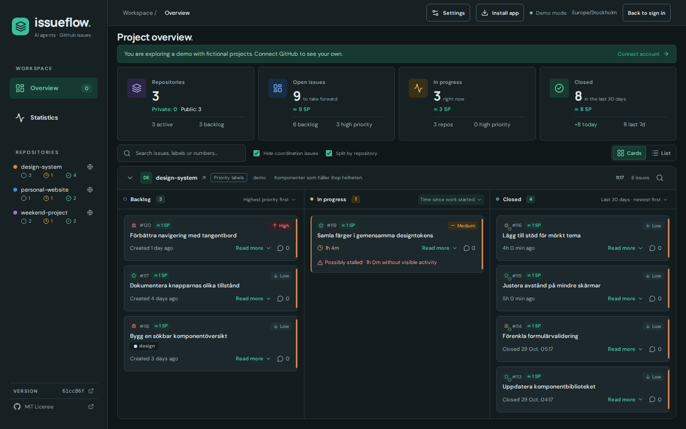
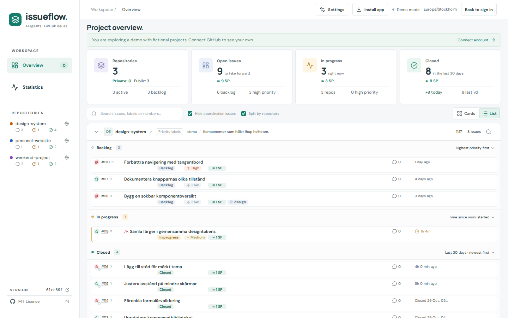
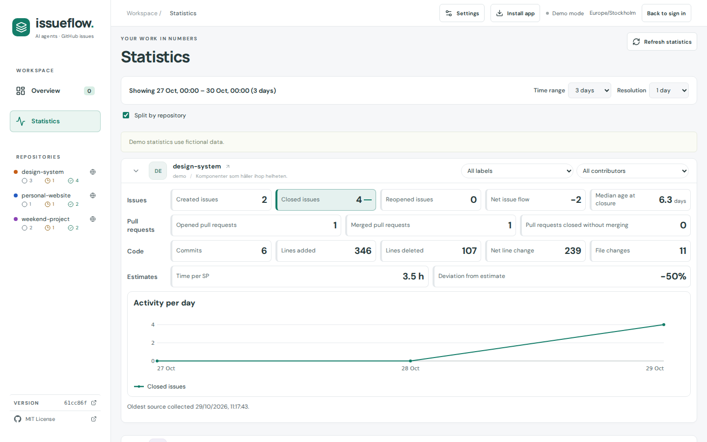
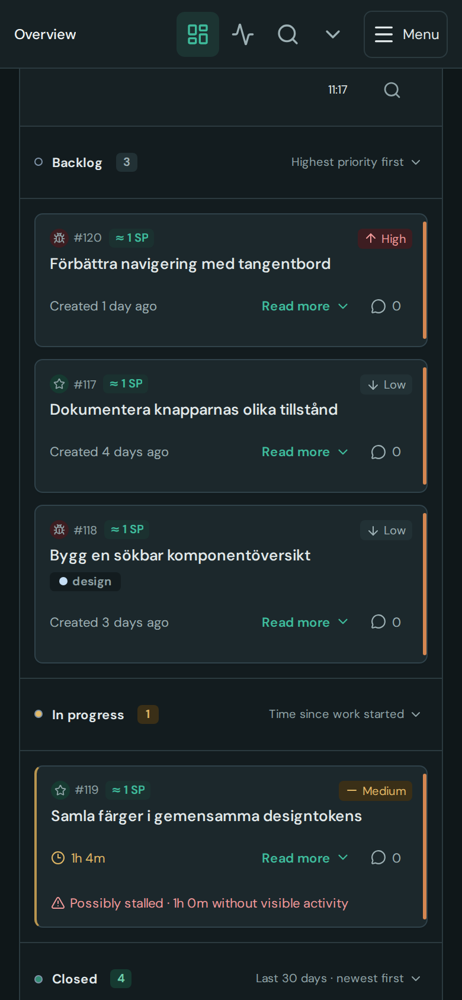

# Issueflow

**See what your AI agents are doing, right from your GitHub issues.**

Issueflow turns the issues your agents (and you) work on into one live board: what's planned,
what's running right now and what just shipped, across all your repositories. There is no
server and nothing to set up: it runs in your browser and talks to GitHub directly.

**[Open Issueflow →](https://solwation.github.io/github-dashboard/)** · try the demo, no account needed



## Why Issueflow

- **One board for every repository.** Backlog by priority, In progress with live elapsed time,
  and the last 30 days of Closed work, split per repository or combined.
- **Built for agent workflows.** See which session owns an issue, spot work that may have
  stalled, and follow new comments and moves as they happen.
- **Know how long things take.** Story-point estimates, remaining-time forecasts and actual
  durations, calibrated from your own history.
- **Statistics that answer real questions.** Issue flow, pull requests, code churn and estimate
  accuracy per repository, label or contributor.
- **Private by design.** Your token and cached data stay on your device, encrypted with
  non-exportable AES-GCM keys. There is no backend.
- **Works everywhere.** Installable app with background notifications, phone layout, QR
  sign-in handoff, light and dark themes, Swedish and English.

| List view | Statistics | Phone |
| --- | --- | --- |
|  |  |  |

*Screenshots use the built-in demo with fictional projects.*

## Get started

1. Open **[Issueflow](https://solwation.github.io/github-dashboard/)**.
2. Choose **Explore a demo**, **Follow public repositories** (no key needed), or connect your
   account with a fine-grained GitHub token (**Issues: read** and **Metadata: read**; add
   **Contents: read** and **Pull requests: read** for closing-commit details).
3. Pick your repositories. That's it.

Want your agents to keep the board accurate? Point them at the
[Issue workflow instructions](public/ISSUEFLOW.md): priorities, work labels and ownership
claims that Issueflow understands.

## Run locally

Requires Node 22.20+.

```sh
npm ci
npm run dev
```

`npm test` runs unit tests, `npm run test:e2e` runs browser tests and `npm run build` type-checks
and builds. See the [setup and technical guide](docs/guide.md) for OAuth sign-in, security and
deployment.

## Learn more

- [Feature reference](docs/features.md): board, settings, notifications, release notes and contributor details
- [Setup, OAuth, security and board behavior](docs/guide.md)
- [Issue workflow instructions for AI assistants](public/ISSUEFLOW.md)
- [Repository development workflow](AI.md) and [design rules](DESIGN.md)
- [Orchestra policy](.orchestra/project.md): `/orkester` uses
  [dirigenten-och-orkestern](https://github.com/solwation/dirigenten-och-orkestern) **v0.6.0**,
  pinned as a squashed Git subtree in `.orchestra/shared`
  ([update policy](.orchestra/project.md#upstream-update-discovery),
  [installation guide](.orchestra/shared/INSTALL.md))

[MIT License](LICENSE) · © 2026 [Olof Wingren](https://github.com/solwation)
