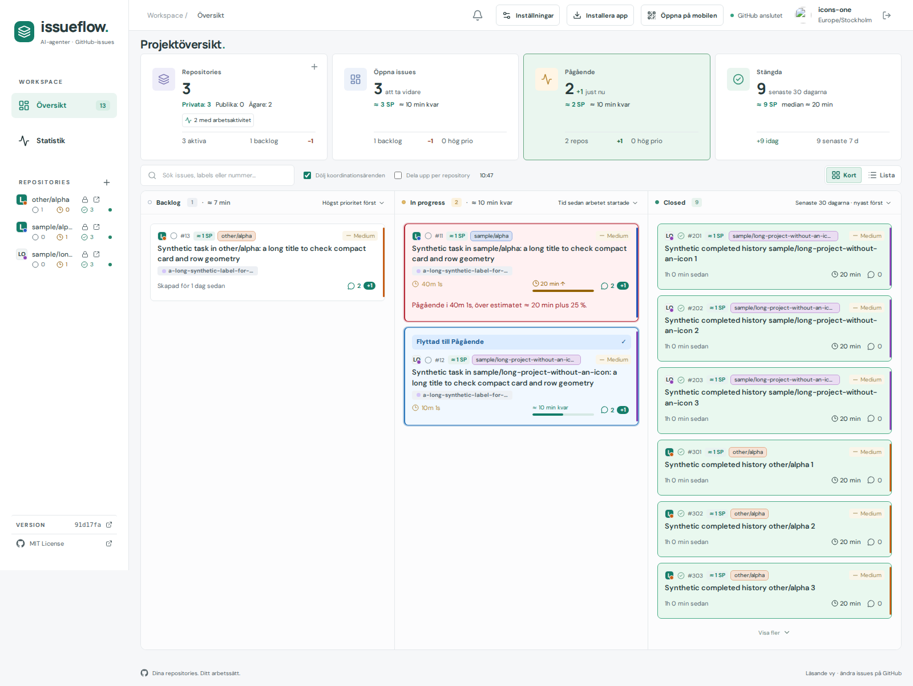
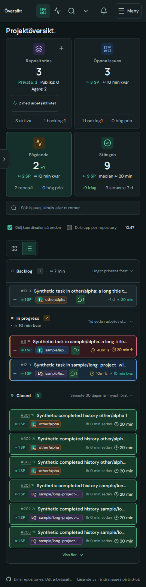

# #395 — recover available project icons

Baseline91d17fa. kvarteret-lunden already has a valid root icon.svg. Actual public GitHub Contents listing/file were run through the unchanged production SVG decoder in Chromium: fresh discovery gave PNG using2Contents reads; a pre-existing empty result suppressed all reads. The reporter’s browser/token/cache was not inspected, so this proves the cache failure mode, not its exact private occurrence.

Legacy empty results from the first artwork release are retried once; successful old artwork remains usable. New empty results retain the normal24-hour cache. Explicit status-button/F5/Ctrl+R refresh retries only missing artwork for the chosen scope. Background/hover paths are unchanged. Existing generation/account/selection guards, request limits, quota reserve and encrypted persistence remain. No repository names or owner avatars are hard-coded in runtime.

Checks:7icon unit/transport/cache/security tests;21release-note checks; production build. Browser: manual single-project recovery adds exactly2Contents reads, does not refetch another positive icon or unrelated missing icon; actual document reload preserves icons/cache; decode fallback and account isolation pass. Design matrix40combinations:Cards/List,split/combined,light/dark,1600×1000/1000×900/390×844touch/844×390touch/320×568touch. Zero measured page overflow; fixed16/20pxicon boxes and aligned project color dots. Screenshot data are synthetic accounts/issues, using the existing L artwork shape; no real private responses or credentials are committed.

The original browser cache test used Ctrl+R, which the app intercepts as manual data refresh. Since that now intentionally retries a missing icon, the reload assertion was corrected to page.reload(); only the affected case reran. The full5-size matrix required its explicit PROJECT_ICON_MATRIX flag; that missing coverage was run once with the flag. An earlier debug attempt repeated the default2-size set while diagnosing startup delay. No other broad suites ran. Screenshots predate the commit and show baseline91d17fa in the footer; their runtime source is this delivery, not that parent revision.

Representative desktop/mobile screenshots were visually reviewed, including narrow/landscape cases saved in the private full archive. Browser evidence shows layout/visible L artwork with synthetic project names; actual public Lunden asset decoding is recorded separately in before-resolver.json. This is local Chromium verification, not a claim about the user’s current cached browser.

Publication follows the normal Actions gate; implementation closure is separate from Pages publication. No gate is bypassed. Final revision/Actions/live smoke will be recorded on the issue.
