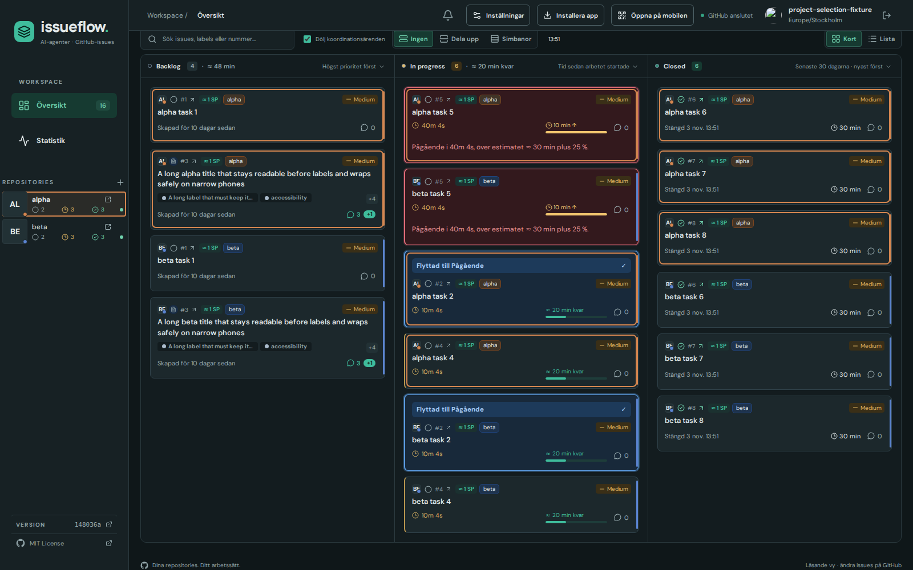
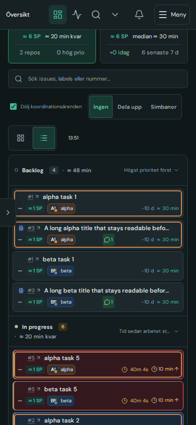

# #397: browser baseline audit

Verified from base `148036a` on 2026-11-04 in the isolated
`dashboard-takeover-397` checkout, using Node 22.20 and the project's bundled
Playwright Chromium revision **1248**. No browser executable override was used.
The six independent specs ran once: **35 passed, 20 failed**, in 2.4 minutes.
These failures reproduce with the matching browser, so the original cloud
browser revision mismatch alone does not explain them.

| Spec | Diagnosis | Correction and verification |
| --- | --- | --- |
| `closed-progress-label` | Three stale expectations required all four label chips to remain inline, although responsive cards now expose hidden labels through `+N`. | Assert the complete visible-plus-overflow label set and continue asserting no in-progress label on closed Cards/List details. All four viewport cases passed. |
| `list-alignment` | Two font-dependent 44px baseline assumptions (42px here); one unopened repository search; one direct text-node selector invalidated by #398's issue-number link. | Keep the compact upper bound and all before/after alignment checks; open the search using its real button; measure text inside `.card-issue-link`. All four affected cases passed; other cases were green in the baseline. |
| `combined-repository-selection` | Six real dark-theme colour mismatches: the frame used 75% project colour plus white, but the shared icon corner used 75% project colour plus the text token. | Restore the icon corner to the established palette's white mix. Selection/state flow and all five dark viewport matrix cases passed; five light cases were already green and their CSS is unchanged. |
| `list-repository-chip` | A valid two-pixel metadata height difference from the combined chip's two 1px borders around its shared 16px icon slot. Number/title offsets still agreed within 1px. | Bound the row-height difference to those two border pixels, retaining all column alignment, chip identity, truncation and page-overflow checks. Full Cards/List split/combined breakpoint test passed. |
| `mobile-relations` | Four exact-total request counts included legitimate retries of the deliberately denied metadata lookup. One rectangle check incorrectly required horizontal separation even for elements in separate vertical rows. | Assert each successful lookup is fetched once, all five identities are requested, and denied lookups stay bounded to two attempts per view mount. Check full rectangle separation. All five desktop/touch cases passed. |
| `overview-estimates` | One stale future-start expectation ignored #375's intentional clock correction from a received GitHub timestamp. The other three cases passed. | Assert no unknown-start warning after correction and continued local countdown from the corrected time. The affected case passed; pure future-boundary logic remains covered by unit tests. |

No sidebar test files were changed: `sidebar-project-layout` and
`repository-board-visibility` belong to #399's separate audit. The #398
card title/issue-number interaction is preserved.

The first affected rerun passed 20 of 21 cases and retained the chip-height
failure for inspection. After its diagnosis, a six-case rerun passed the chip
matrix and all relation cases, including the added retry bound. Together with
the reused baseline successes, every case in the six scoped specs has passing
evidence. The whole suite was not rerun.

Additional checks: **32 unit tests passed** across `repository-color`,
`overview-estimates` and `issue-relations`; `npm run build` passed after the
runtime fix (source integrity, Vue/TypeScript and production bundle).
`git diff --check` passed. No dependencies or lockfiles changed.

## Visual and design review

The only runtime change is the dark icon colour mix; icon size, geometry,
interactions and light-theme styling are unchanged. The shared frame matrix
checks Cards and List, split and combined, at 1600×1000, 1000×900, 390×844,
844×390 and 320×568; phone contexts use mobile/touch. It includes long titles
and labels, unread movement/comments, timeout, remaining and actual time.
Its geometry checks confirm no horizontal page overflow or unexpected row
heights. Number/title alignment remains within 1px; the documented combined
chip border difference is at most 2px.

Representative screenshots were visually inspected for wide/narrow desktop,
portrait/landscape phone and narrow phone, including light/dark parity. No
new overlap, misplaced metadata or row-height problem was found. The corner
colour matches the selected frame and sidebar project colour in dark mode.
The synthetic fixture's empty avatar URL can display a broken avatar; that is
not the product change under review. Motion, keyboard/touch names and target
sizes are unchanged.

## Evidence

Local artifacts are under `/tmp/dashboard-takeover/evidence397/`:

- `baseline.log` and `baseline/`: original 55-case run and failures, with light matrix captures.
- `rerun1.log` and `rerun1/`: 21 affected cases, dark matrix captures and geometry JSON.
- `rerun2.log` and `rerun2/`: final six-case success, long-name chip and relation captures.
- `build.log`: final production build.

The conductor reviews the integrated change and attaches selected sanitized
screenshots to the issue completion evidence. Publication, release metadata
and #399's sidebar verification are separate conductor responsibilities.

Conductor inspected the combined source and representative final dark screenshots below; integrated production build and54release/publication metadata checks passed. Captures use synthetic issue data, parent revision148036a in development footer. Publication follows Actions separately.

