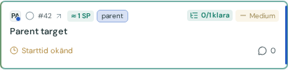
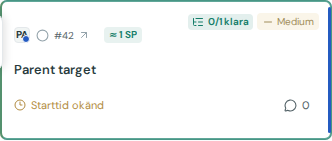

# Issue 398 verification

Based on22624f6. Only the card’s #number (with external-link arrow) opens the GitHub issue. Title and surrounding upper surface use the existing description toggle. Type/project icons are outside the GitHub link. Nested controls and text selection retain their existing behavior. Keyboard description button remains; issue link has a localized accessible name, native new-tab behavior and44px touch target. Demo link has no href.

Production build and54release/publication metadata tests passed. Browser:22details/compact layout checks passed, covering Cards/List,split/combined,both themes,1600/1366/1000/390touch/844touch/320touch,long labels,title wrapping,unread,comments,remaining/actual-time andtimeout states.15affected navigation/relation/cache identity cases passed. Title-link locators updated to title text; external-action assertions target the number. Targeted final keyboard/tap check recorded on issue. No full-suite claim.

Synthetic screenshots below visually inspected: no overlap/overflow,compact desktop row and touch number target. Phone card top accommodates the44px link, title retains its normal typography. No real GitHub responses/accounts in screenshots. Captured development runtime before commit; images are cropped to the relevant card.

