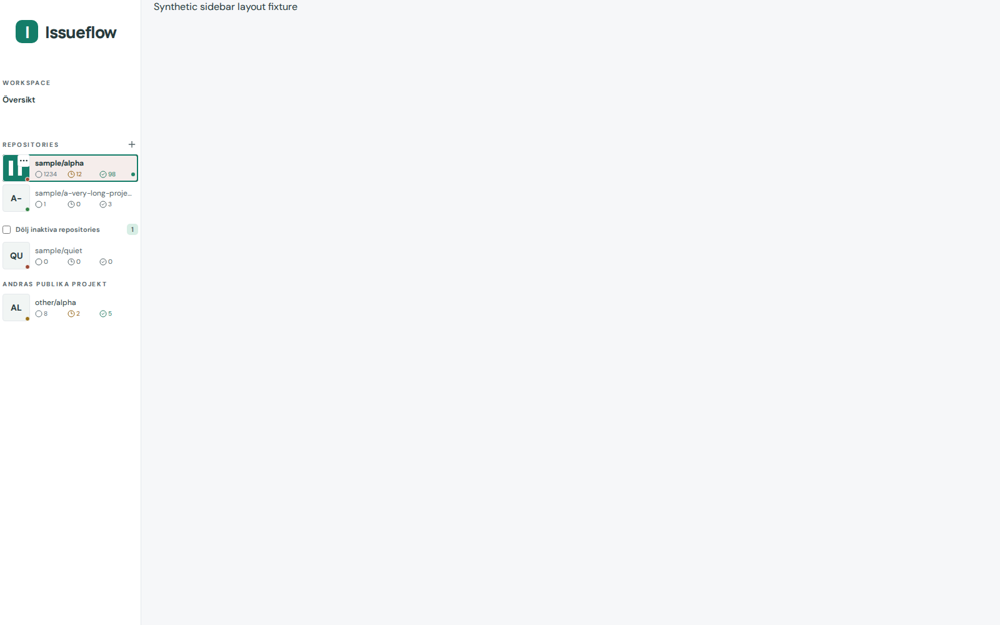
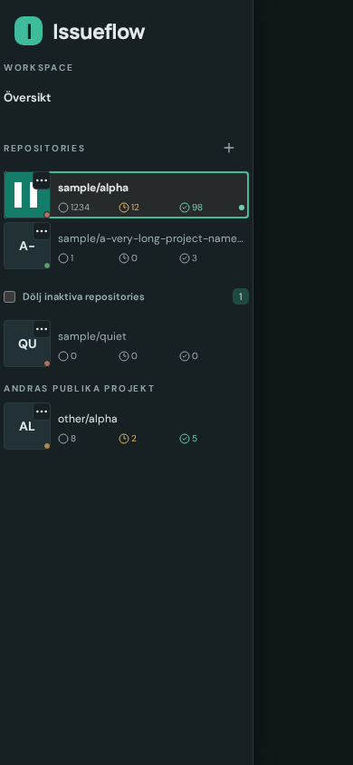
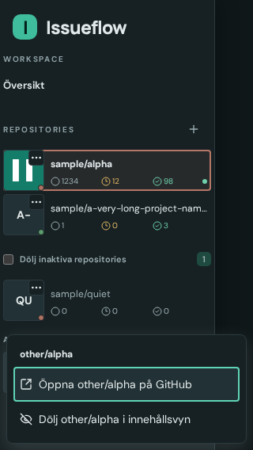

# Issue #399 verified handoff

Reviewed revision: b20de4406a2ae331d547abc078d8863577f28bd5 (Refs #399), based on148036a. Worktree /home/devcontainers/dashboard-takeover-399 is clean. No main push, issue closure or release metadata edits. Own dev/preview process trees stopped; ports5399/4399 no longer listen.

## Delivered behavior

Repository names now have the entire top text line beside the existing44px desktop/52px touch full-row artwork; counts/unread remain below. Permanent trailing GitHub/Pages/visibility reservations removed. A clearly named native context-action popover opens from the existing artwork square, preserving the lower-right color dot. Hover/focus reveals its ellipsis cue; touch keeps the cue visible and has a52px target. The text/count link still selects a project. Actions include canonical GitHub, available Pages and show/hide; private status remains available in the menu. A slot supports future actions.

Native top-layer popovers avoid clipping by the sidebar scroller and are clamped within the viewport. Arrow keys/Home/End navigate, Tab leaves/dismisses, Escape restores the opener, outside click dismisses, and moving the scroll anchor closes the menu. Closing synchronizes open state/listeners immediately; reopen checks :popover-open directly rather than a potentially delayed native toggle-event ref. aria-expanded is updated from actual popover state. A closed context control allows Escape to reach the phone drawer handler. No App changes were required.

Workspace section caption/navigation now share Repositories'4px inset and full section width. Sidebar widths, project row heights and content Cards/List/heading16/20px artwork defaults retained;950px icon rail remains unchanged. Canonical names, active/inactive/external, selected/hidden and unread states preserved. English/Swedish action label and docs/features.md updated. README left to397's ownership.

## Geometry and evidence

- after-geometry.json:42 combinations (1600x1000,1000x900,1000x1100 touch,950rail,390x844 touch,844x390 touch,320x568 touch × Auto/Yes/No × light/dark). Workspace/project width delta0px and left-edge delta0px wherever projects are visible. Page/sidebar overflow0px, icon/row and name/count alignment within1px, all count-fit assertions true including four digits.
- Shared section widths:217px wide desktop,186px narrow/coarse tablet,271px phone/landscape,263px tiny phone; both sections start at4px. Existing1px right sidebar border yields5px right outer inset.
- name-width-comparison.json compares the same synthetic selected project with prior #396 evidence: desktop97→161px, narrow66→130px, coarse tablet50→122px, phone/landscape87→207px, tiny79→199px. Project row width itself unchanged.
- menu-geometry.json covers desktop,320portrait and844landscape touch: trigger44×44 or52×52; long-name menu320×231px desktop,304×282px tiny,320×261px landscape, each fully within viewport. Menu item targets55px high desktop and58–79px on touch (minimum44px enforced).
- Captures: after-{viewport}-{light,dark}.png (14 regular captures); actions-{1600x1000,320x568,844x390}-{light,dark}.png and actions-long-{same viewports}-light.png. Older bare actions-{viewport}.png files precede final lifecycle corrections and are not the preferred final captures; geometry/visuals are unchanged but the explicitly themed captures above were regenerated on final source.
- Visually inspected desktop light sidebar,390dark sidebar, long320light menu,320dark menu and844landscape dark menu. Full names wrap inside popovers; no clipped menu/overlap/page overflow. Actual setTheme() API, reduced motion and painted frames used. All fixture data/artwork is synthetic.

## Checks and evidence reuse

All22 distinct scoped browser cases have green evidence, with risk-based reruns rather than another broad suite:

1. E2E_DEV_PORT=5399 E2E_PREVIEW_PORT=4399 E2E_REUSE_SERVER=1 SIDEBAR_LAYOUT_EVIDENCE=/tmp/dashboard-takeover/evidence399 npx playwright test e2e/sidebar-project-layout.spec.ts e2e/sidebar-visibility-pages.spec.ts e2e/mobile-sidebar.spec.ts e2e/repository-board-visibility.spec.ts --workers=1:15 cases green (mobile drawer3 + unchanged desktop sidebar3; board visibility desktop/tablet/phone3; scoped42-case geometry/default-icon guard2; rail/phone visibility/Pages4). Seven menu-specific cases required follow-up.
2. Same environment, npx playwright test e2e/sidebar-project-layout.spec.ts e2e/sidebar-visibility-pages.spec.ts --grep 'repository context|desktop|narrow|touch-tablet' --workers=1: six Pages/visibility cases green after waiting for the native popover's asynchronous initial-focus event before sending keyboard arrows. One rapid close/reopen lifecycle issue remained.
3. Final source, same environment, npx playwright test e2e/sidebar-project-layout.spec.ts --grep 'repository context' --workers=1: one case green (three viewport contexts;2.9s/3.7s runner). Covers immediate Escape→ArrowDown reopening, initial focus, arrows/Home/End, Tab dismissal, visibility action, outside dismissal, viewport bounds,44px targets and final themed captures.
4. npm run build passed on final runtime source (source integrity, Vue/TypeScript, Vite build). git diff --check passed.

The final runtime correction only replaced stale cached native-popover lifecycle state with actual DOM state and immediate close cleanup. Prior green geometry, widths/themes, default Cards/List artwork, parent drawer, canonical URLs, visibility and Pages evidence reused because layout/action rendering/URLs were unaffected; final lifecycle case re-exercised shared menu/focus/show-hide paths. No full suite claimed or unchanged logic-unit tests invented for this UI change.

The two sidebar specs deferred by #397's audit are now covered here: sidebar-project-layout (three cases including42 geometry combinations/default-artwork/menu flow) and repository-board-visibility (desktop/touch tablet/phone). Existing stale short-name Settings assertions were corrected to canonical mixed-owner Auto names; no Settings runtime code changed.

## Scope/limits and follow-up

Only SidebarRepositories/new RepositoryActions/minimal relevant sidebar CSS/i18n, four owned sidebar E2E specs and docs/features changed. No ProjectIcon, App, cache/resolver/event/package/lockfile/metadata edits; preserve397's independent dark-color correction on integration. Browser evidence uses Chromium and synthetic component/API fixtures. Native Popover support is the implementation platform; no legacy browser fallback or live private API test claimed.

Conductor owns final integration/review, prepared398/397/399/400/401 delta, bilingual release metadata, closure and Actions/Pages/live checks. Approximate phases: context/layout3min, implementation/docs7min, targeted verification/design7min, lifecycle and stale-selector corrections6min. No delegation. Servers stopped before handoff.

Conductor integrated this source with397008ebe4, reviewed the combined diff and representative screenshots, and passed the combined production build and54release/publication metadata checks. These captures are synthetic; the component fixture isolates geometry, while the actual-app cases verify integration.

