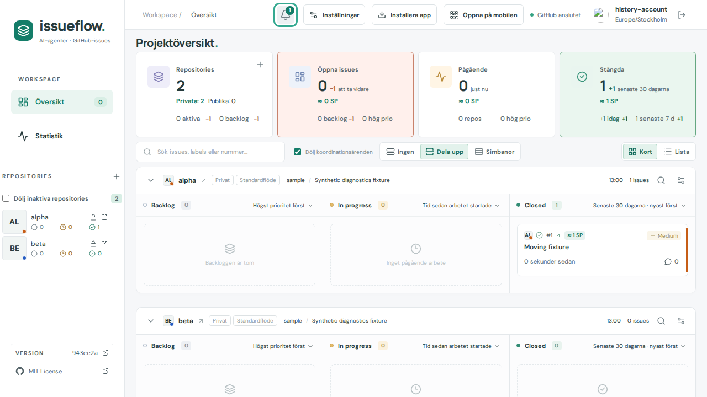
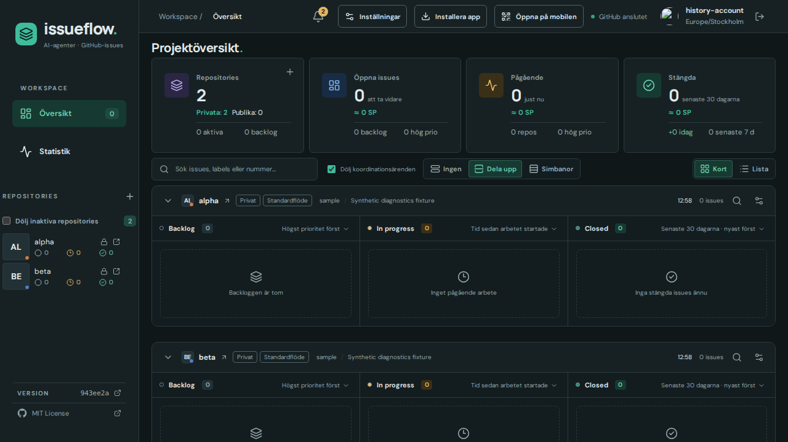

# Issue 400 verification

Based on943ee2a. Live observed issue movements (including integration handoff, closure and reopening) enter the encrypted account-local event history as information. Initial loads, unchanged updates, workflow-setting edits and failed/loading responses do not create movements. Pending closures keep the previous verified state until single-issue verification confirms the result; no guessed closing event is recorded.

Information observed while the document is visible AND focused is saved as seen. Hidden or unfocused information stays unseen and contributes to the bell count, including after returning to the dashboard. Warnings/errors remain unseen regardless of foreground state. Badge severity considers only unseen entries, choosing error(red),warning(orange),info(green). Existing bounded100entry history/account isolation/encrypted persistence is preserved.

Checks:6targeted pure tests passed;54release/publication metadata tests passed; production build passed. Existing3diagnostic browser flows passed (grouping/retry/dedup/reload/account encryption/isolation/public browsing;5viewports in both themes with dialog/header geometry and keyboard focus). New state-change and warning-color flows passed; final affected state-change rerun includes a held single-issue verification, asserting no premature event, then confirmed closure, foreground/background behavior, unchanged-refresh dedup, red-over-green precedence and explicit read acknowledgment. New warning check asserts actual amber background in both themes. Initial new flow tried refreshing before initial sync finished; adding the normal readiness assertion fixed that test race. Screenshot review caught theme/closure animation frames; captures now use reduced motion and settled theme surfaces. Only affected tests rerun; no full-suite claim.

Synthetic accounts/issues only. Images visually inspected. Development runtime footer shows parent943ee2a because captures precede commit. No real issue responses or tokens committed. Background state is simulated through document.hasFocus in the focused browser case; production checks both visibilityState and hasFocus on receipt.

