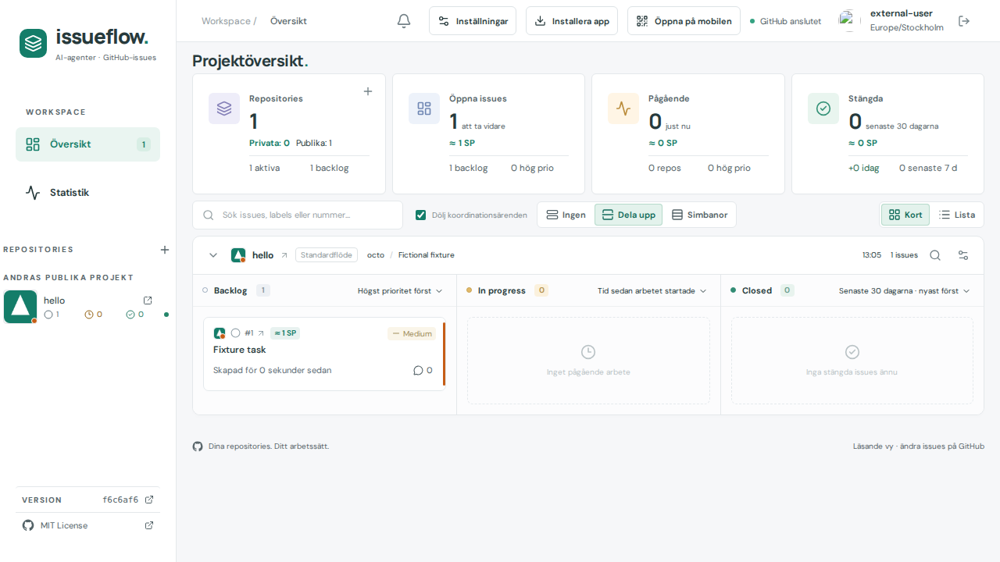

# Issue 401 verification

Based onf6c6af6. The reported external public project DasKrokodil/historia-globen has1055byte `img/favicon.svg`, referenced by its root index. Prior discovery never visited img. Generic discovery now includes img/images at root and under public/assets, within the unchanged6request cap and existing64KiB/security/quota constraints. Negative cache version2 retries old misses once after expanding discovery; positive artwork remains reusable. Fresh negative results retain24hour caching. No project or owner name is hard-coded in runtime.

Actual public GitHub Contents root/img/file responses were passed to the production resolver and browser SVG decoder. Source blob2a8969e5f8ea4e0ea1cbd8a97ee51612a2e88e3d decoded to64pxPNG after exactly3Contents reads; actual compass artwork visually inspected. Only provenance/result metadata is committed, not repository response snapshots or credentials. See public-icon-result.json.

Checks:13project-icon unit/cache/security tests plus54release/publication metadata tests passed; production build passed.2targeted browser flows passed: adding an external project discovers img artwork, saves it encrypted and reuses it after actual page.reload without more Contents reads; existing positive/missing/broken/account isolation flow remains green. No rendering size/default changes: prior final Cards/List viewport matrix reused. Synthetic external-project screenshot visually inspected; runtime footer shows parentf6c6af6 because capture preceded commit. No full-suite claim.

