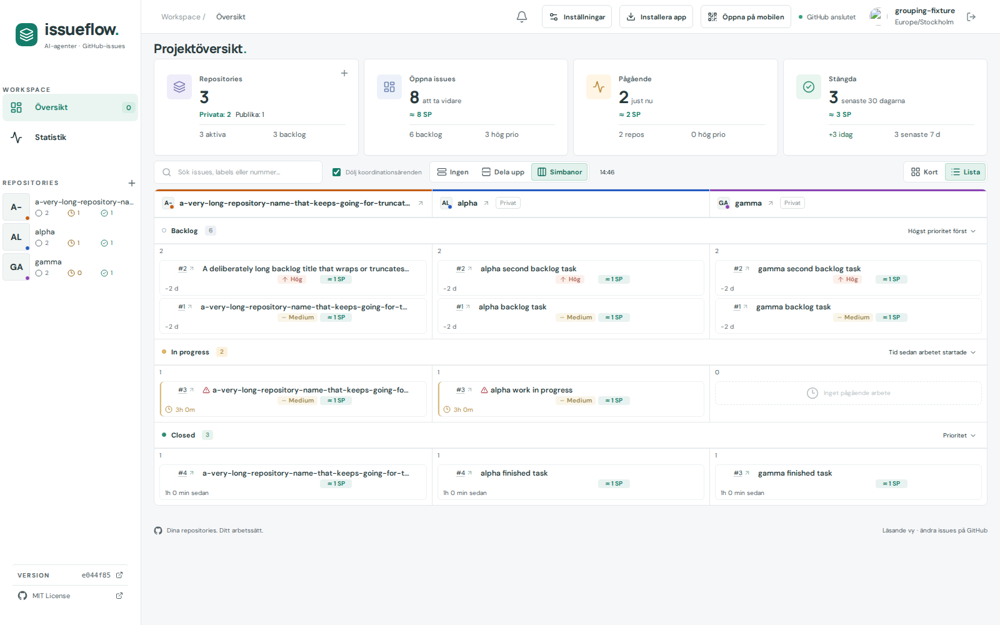
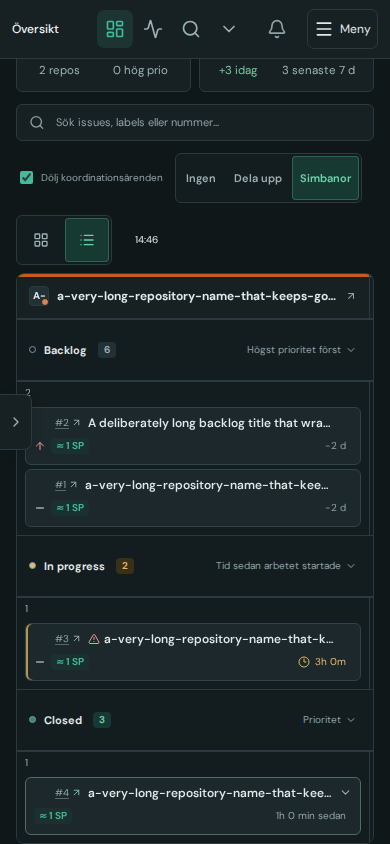
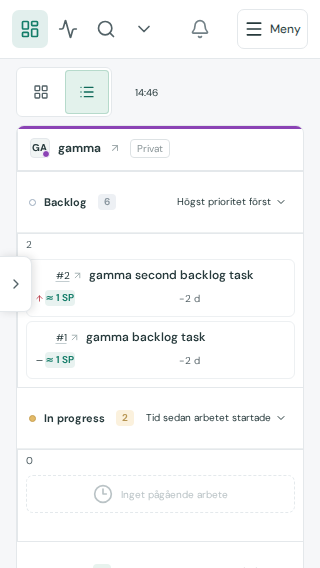

# Issue402 verification

Basee044f85. List swimlanes use one native table: project headers, shared status bands, joined project cells with shared row heights. Reuses existing list rows/details/counts/estimates/limits. No independent project collapse in List; repeated sidebar activation only reveals the column. Cards bands retain collapse behavior. All widths remain inside a keyboard-focusable local horizontal scroll area on phones as well as desktop. Native header associations identify project and status. Global status sort menus float in the top layer to avoid scroll-container clipping and close when their anchor actually moves; delayed no-movement scroll events do not dismiss a just-opened menu.

Checks: existing grouping behavior now passes one desktop flow (counts/filtering/NoneSplitSwimlanes/saving/reload/QR migration/issue expansion/column navigation/Card collapse) and3touch flows390/844/320 (joined List table/local scroll/last column/issue popup, Cards stacked). New matrix passed60grouping/view/theme/size combinations with0page overflow;10List-table cases assert equal status cell y/heights, project header/cell x alignment and joined borders within1px, row content overflow<=1px, compact shared headers and unclipped sorting. Sizes1600/1000/390touch/844touch/320touch, both actual themes. Source/default regression caught optional Boolean prop default and was corrected; no lasting Cards behavior change. Visual inspection caught inherited oversized mobile status headers and corrected them. Final sorting test caught queued focus/scroll dismissal; DOM anchor comparison and preventScroll focus resolved it. Only affected flows repeated; no full suite claim.

Synthetic fixtures only. Screenshots below visually inspected; footer shows basee044f85 because captures precede commit. Narrow phones preserve the joined table and scroll to later project columns. Final production build/release metadata checks recorded on issue. No private response snapshots committed.

