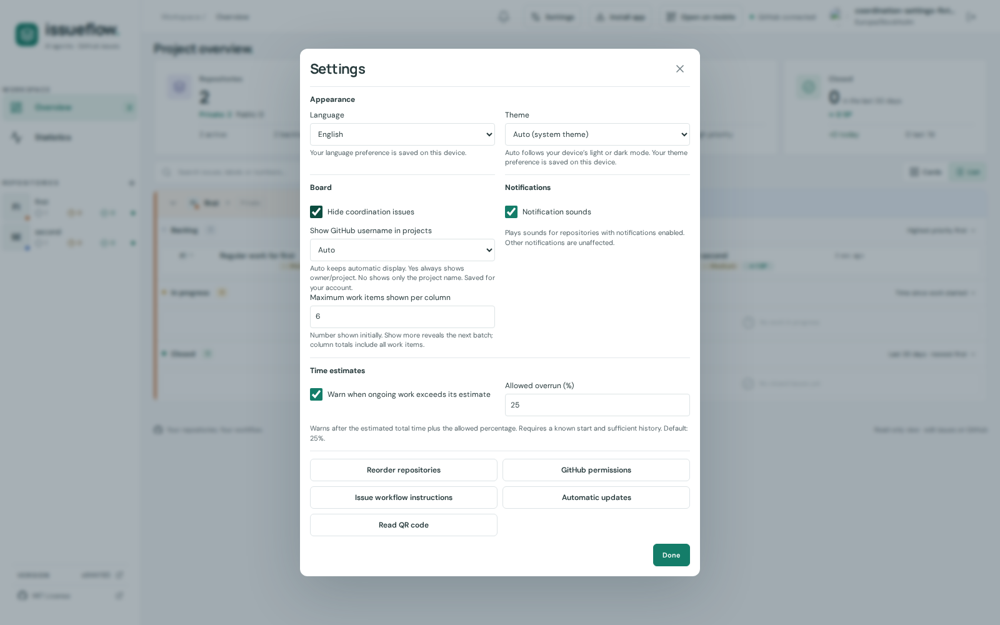
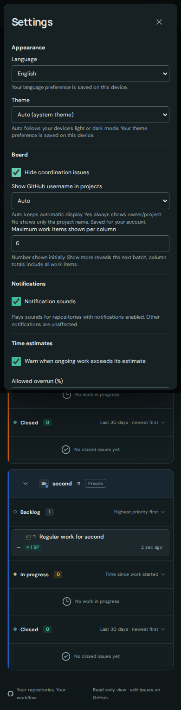

#403 revision b1447c2b367baf32d07b5f33ce32767b262735ff atop e044f85.
Runtime: LanguageSettings Board section new existing translated checkbox, App existing ref v-model connected and old toolbar checkbox removed. No preference/default/save/restore/API/grouping logic changes. No CSS changes. Existing Settings toggle spacing/color/44px wrapper reused; disabled outside usable workspace like adjacent account controls.
Checks: mandatory build green (build.log); source diff integrity green; 11 focused E2E cases have passing evidence: 10 initial in browser.log/browser plus unrelated third refresh-shortcut fixture corrected to valid GitHub issue-array payload and only that1rerun green2.1s in refresh-fixture.log. Original invalid fixture failure preserved in browser.log. No runtime queue bug; object-versus-array fixture error explained the stalled queue. Parent accepted diagnosis without redundant base run.
New3cases: desktop1600x1000, rail950x900, mobile/touch390x844. Default hide=true; keyboard Space changes tofalse; Cards/List all3groupings show included coordination issues; encrypted record read and reload preservefalse; language Sv->En existing strings; Enchecktrue hidescoordination; 44px touchwrapper; nooverflow or plaintext preference/repo inlocalStorage. LightdarkScreens eachcontext in browser/coordination-setting-*/settings*.png. Visually inspected1600light,950dark,390dark: nooverlap/controlreadability issue. Existing board card/row geometry unchanged;402conductor owns final combined matrix.
Evidence screenshot filenames use synthetic fixtures only. Ownports5403/4403 verified via /src/App.vue and all server processes stopped. Clean checkout, scoped commit, no push/closure/metadata.
Approxphase times: context/planning1min, implementation+testprep3min, build/browser1min, screenshotreview/fixturediagnosis/handoff2min. No30min threshold.

Conductor reviewed mergedApp/Settingssource and screenshots. Synthetic fixtures only; finalcombinedverification follows.

