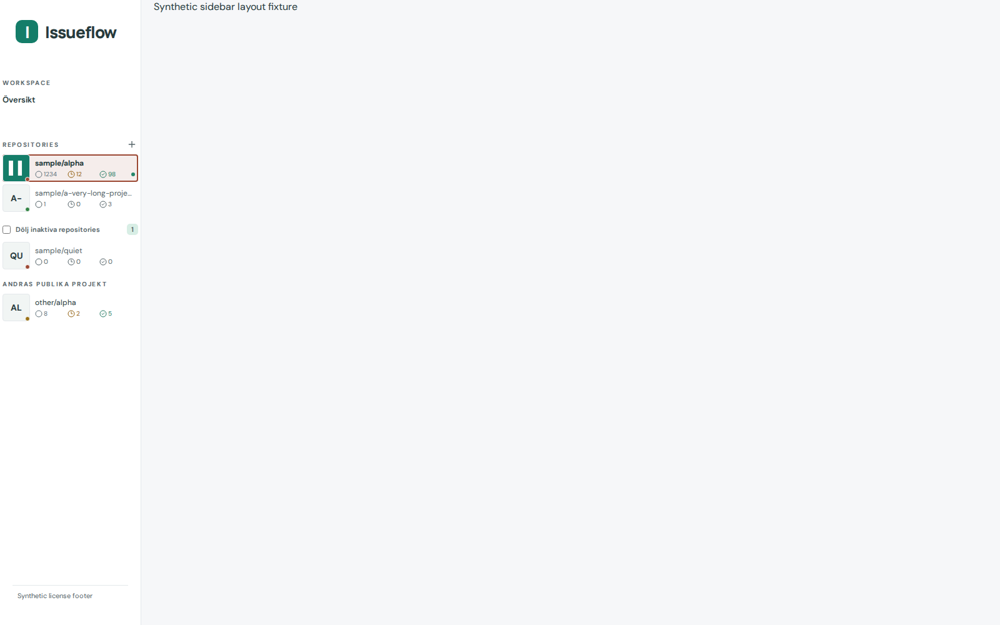
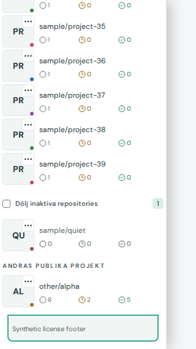

# #404 handoff

Revision: 9e4360f103745a844d2c98471944d232d0524d68 (Refs #404), based on e044f85. Checkout /home/devcontainers/dashboard-sidebar-scrollbar is clean. Own dev/preview server trees stopped; ports 5404/4404 free. No push/closure/metadata or App/Settings/table/cache changes.

The unwanted scrollbar came from the project section's `overflow-y:auto` plus flex shrinking inside the fixed sidebar. Even four synthetic projects had a 295px client area with 300px scrollable visual content, enough to create an unnecessary internal scrollport. Forty-four projects were constrained to717px while their content measured2220px. The fix makes the project section natural-height with visible overflow and makes the whole sidebar the single automatic vertical scroller, preserving direct children's natural heights. It does not hide vertical content or apply custom scrollbar paint.

Afterwards the small desktop sidebar has no scroll range (1000px client/content), the project section has visible overflow and no scrollport, and44-project content uses the whole sidebar (1000px viewport/2498px content). Narrow desktop:900/2494px. Portrait phone:844/2804px. The five-pixel visual overhang remains harmless visible paint instead of a nested scrolling area. Whole-sidebar scrolling is available when genuinely needed.

Checks:

- Baseline: E2E_DEV_PORT=5404 E2E_PREVIEW_PORT=4404 E2E_REUSE_SERVER=1 SIDEBAR_SCROLL_BEFORE=1 SIDEBAR_LAYOUT_EVIDENCE=/tmp/dashboard-swimlane-table/evidence404 npx playwright test e2e/sidebar-project-layout.spec.ts --grep 'whole sidebar' --workers=1:1 passed, baseline screenshots/metrics captured.
- Final runtime: same environment without BEFORE, npx playwright test e2e/sidebar-project-layout.spec.ts e2e/mobile-sidebar.spec.ts --workers=1:9 existing cases passed, including42 layout/theme/owner combinations, default content16/20px artwork guard, keyboard/touch context actions and6 actual-app phone/desktop sidebar checks. The new scroll test initially overconstrained visible visual overhang; corrected its assertion to require no internal scrollport rather than equal scroll/client heights.
- Final new scroll-only rerun: same environment, npx playwright test e2e/sidebar-project-layout.spec.ts --grep 'whole sidebar' --workers=1:1 passed (18.9s;20.6s runner). Four/44 projects at1600x1000,1000x900,1000x1100 coarse tablet,950rail,390x844 touch,844x390 touch,320x568 touch, both actual themes. Confirms Repositories is not a scrollport, only the sidebar scrolls; keyboard focus reaches the last project, its native context action and the license footer; context popup stays within the viewport; Workspace/project edges and widths remain within1px and page has no horizontal overflow.950rail remains hidden-project navigation.
- npm run build passed on final runtime source; git diff --check passed. No logic unit tests added for the CSS change; no whole suite repeated.

Evidence: scroll-before-geometry.json, scroll-after-geometry.json and scroll-before/after-{viewport}-{few,many}-{light,dark}-top.png, plus scroll-after-{viewport}-many-{light,dark}-bottom.png. Geometry contains24 visible-list combinations; the remaining4 rail combinations verify the list is hidden. Representative desktop few before/after light, desktop many dark bottom and320 touch many light bottom screenshots visually inspected. Last project and footer stay reachable; no row, name, count, artwork, menu or inset change. Additional existing42-case layout captures are after-{viewport}-{theme}.png. Synthetic data only.

Limit: native scrollbar painting is OS/browser dependent (headless Chromium may use overlay scrollbars). Computed overflow properties, scroll ranges, focus reachability and screenshots establish that the nested project scrollport is gone while long-list access remains. No live private account data tested. Conductor owns integration, final review, release metadata and Actions/Pages verification.

Approximate phases: context/baseline3min, CSS implementation1min, focused checks/design4min. Three changed files only: SidebarRepositories.vue, sidebar overflow styles and scoped sidebar-project-layout E2E. Browser slot released.

Conductor reviewed the combined stylesheet/component diff and these synthetic captures before integration.

Final integrated source includes402joinedtable and403Settingsmove. Conductor ran5final combined browser cases:3Settingscontexts, sidebar few/many reachability across28combinations, and60grouping/view/theme/size table combinations; allpassed44s.54release/publication metadata tests and combined production build passed. Source/diff/screenshots/privacy reviewed; no unresolved findings.
